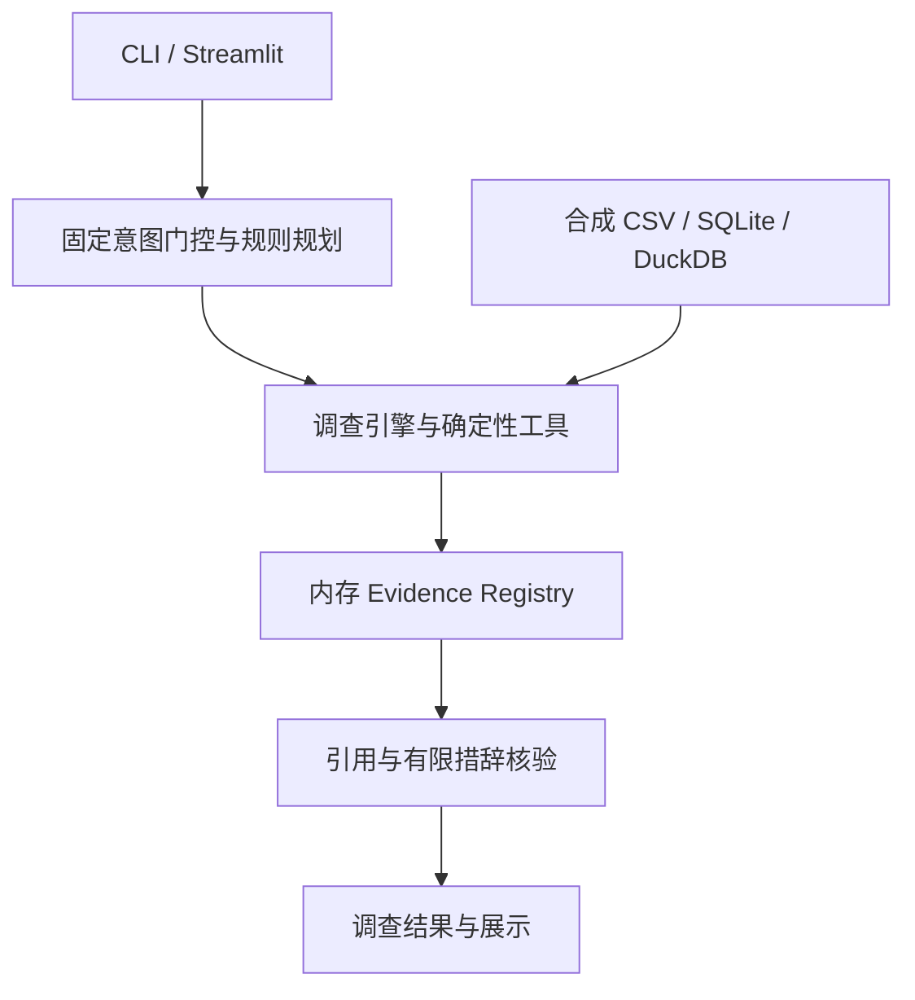

# 产品现状矩阵与测试边界

核对时间：2026-10-27；实现起点 `8fa778bb23d2afcec2dc14dad5e7926fd7de40af`。这是证据索引，不是第二份任务台账；进度只维护在 [M0—M6 计划](FitzSight_Roadmap_2026-10-26.md)。

## 产品范围

面向金融运营数据分析、数据工程和 AI 应用的个人能力展示，核心是转化率、净入金和描述性客户分群三条调查链。当前五个固定演示意图还包括营销质量和错误归因防护，用于保留已有回归。数据为合成数据，不能声称业务收益、生产可靠性或独立职业能力已被证明。可选 A/B 扩展仍在核心之外。

## 现状与证据

| 能力 | 已存在的实现/证据 | 缺口和对应计划 |
|---|---|---|
| 离线执行 | `agent/catalog.py`、`runtime.py`；[十次真实 CLI](validation/2026-10-27-offline-flows.json) | 固定地区/日期，未达 M1-01 参数化验收 |
| SQL 与计算 | `tools/sql.py`、`tools/contribution.py`；SQL 安全、贡献分解测试 | 不能由只读查询推导金融口径已完备；M1 指标定义、M3 业务复算待办 |
| 比例统计 | `tools/statistics.py`；39 项统计测试 | 稀疏差值区间为 null；连续样本边界未统一，M1-03b |
| 证据与核验 | `evidence/registry.py`、`agent/verifier.py`；ID、状态、摘要和有限措辞检查 | N-C1—N-C4 已绑定金额/单位/窗口并重算；其他声明未迁移；内存记录非持久化防篡改审计，M1-02/M4 |
| 数据生成 | `data/generator.py`；[21 表指纹](validation/2026-10-27-generator-fingerprints.json)，弃用警告已修复 | M1-04 已拆分 demo/import：默认导入缺表失败，演示只初始化空目录；见 DATA_MODES.md |
| 数据存储 | `data/store.py`，SQLite/DuckDB 实跑 | 未完成分层、批次清单、水位、对账及恢复；M2 |
| UI | `streamlit_app.py`、`ui/presenter.py`，presenter 单元测试 | 单元测试不代表浏览器交互或陌生人复现；M0-02b 人工验收 |
| Provider | `providers/deepseek_planner.py`，离线 Mock 契约与拒绝测试 | 在线调用、真实延迟/成本未测；不自动启用 |
| 评测 | `scripts/run_evaluation_v2_*.py`，可执行消融与历史留出文件 | 读取历史 JSON 不等于重跑；未达到独立多维留出和盲审，M5 |
| 服务可靠性 | CLI/UI 共用部分 runtime | 尚无 M4 所需持久化调查 API、隔离/恢复和规模实测证据 |
| 展示与所有权 | 历史 PDF/HTML、视频与打包资产 | 不等于本人讲解、独立修改、同行反馈和就业结果；M6 |

路径若以模块开头，均相对于 `src/fitzsight/`。现状矩阵没有把历史状态“已实现”直接转换为新计划“已验收”。

## 测试分类与复现

```bash
python -m pytest --strict-markers -m product
python -m pytest --strict-markers -m competition
python -m pytest --strict-markers
```

`tests/conftest.py` 将竞赛资产模块及混合模块中的指定用例标为 competition，其余默认 product。默认命令仍运行全部测试，不通过分类跳过失败。CI 分别运行两组；第二组即使第一组失败仍执行（取消任务除外）。后续新增竞赛资产检查必须更新分类表；新产品测试默认进入 product。

- product：执行逻辑、SQL/统计、安全边界、规则规划器、离线 Provider mock、可执行评测、启动器与诊断工具。并非全部用例都访问真实外部系统。
- competition：PDF/Deck/备份资产、打包与人工交接、提交预检、历史结果快照。通过只证明相应资产/规则检查，不证明运行时调查正确。
- 混合文件按用例分类：例如 runtime doctor 脱敏、验证脚本 dry-run 和最终机器检查默认不联网留在 product；PDF/视频/打包属于 competition。
- 原留出测试拆为问题路由测试与历史 JSON 检查，两部分断言完整保留；所以默认收集数量由 145 增为 146，不是新加一个业务能力。

本轮收集清单：[默认 146 = product 123 + competition 23](validation/2026-10-27-test-partition.json)，两组交集为空。执行结果见 [RUN-03 验证](validation/2026-10-27-run03.md)。这不是完全隔离的依赖安装方案：pytest 收集仍会导入所有模块，现阶段两组均使用完整 requirements.lock；不声称产品最小依赖安装已验收。

## 当前架构与迁移方向



图示默认离线路径。Provider 仅为可选规划器。计划中的指标语义层、结构化数值声明、导入质量层、持久化审计和 API 尚未补齐。迁移顺序遵循主计划，已完成 import 模式边界，下一步优先数值绑定，沿用现有工具与单机数据库。

旧规划入口见 [归档索引](archive/README.md)。

数值迁移范围与限制见 [净入金数值契约](NUMERIC_CLAIMS.md)，不能将已迁移声明验收外推到整份报告。
